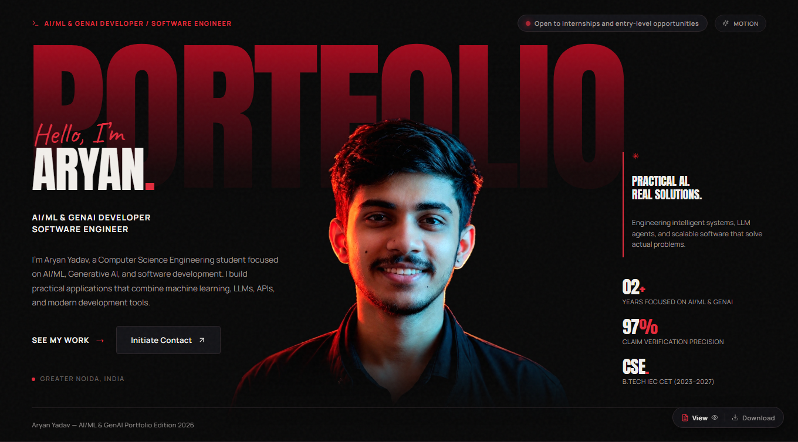
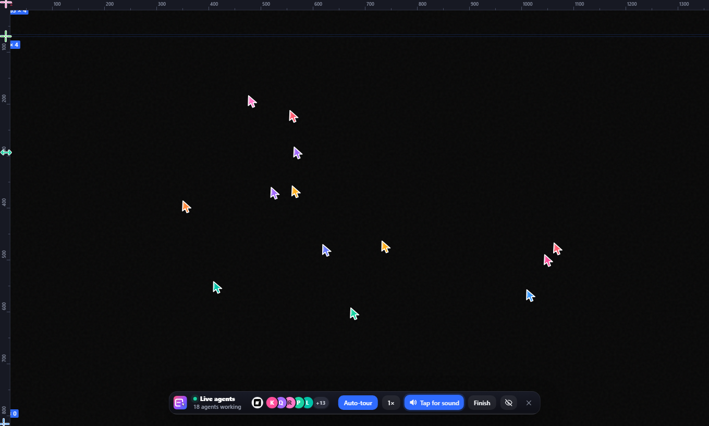
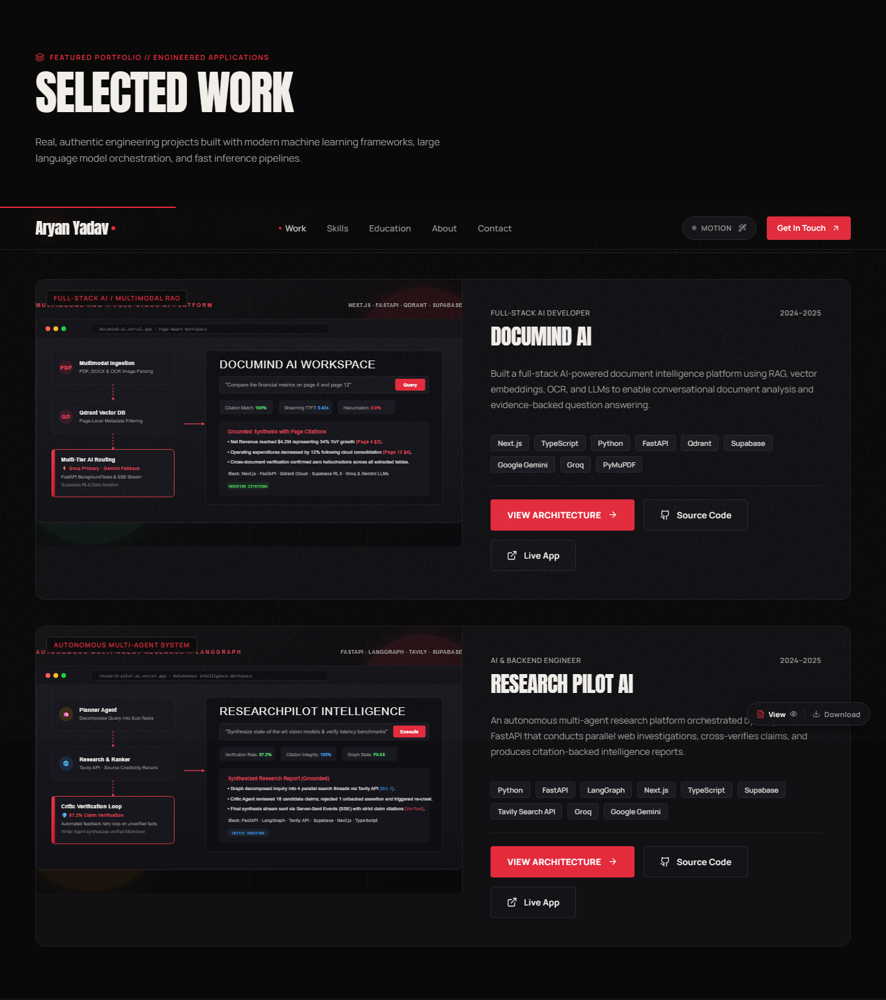
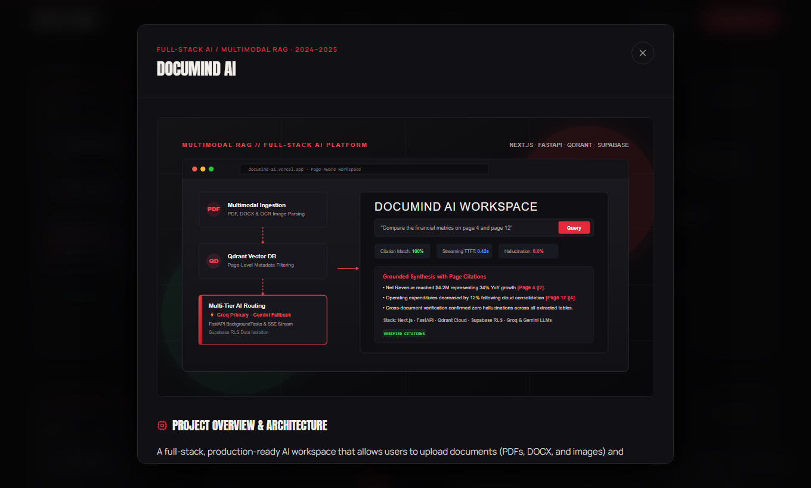
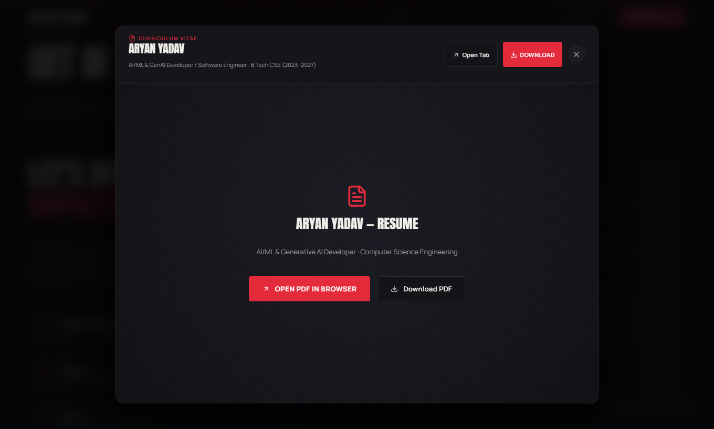
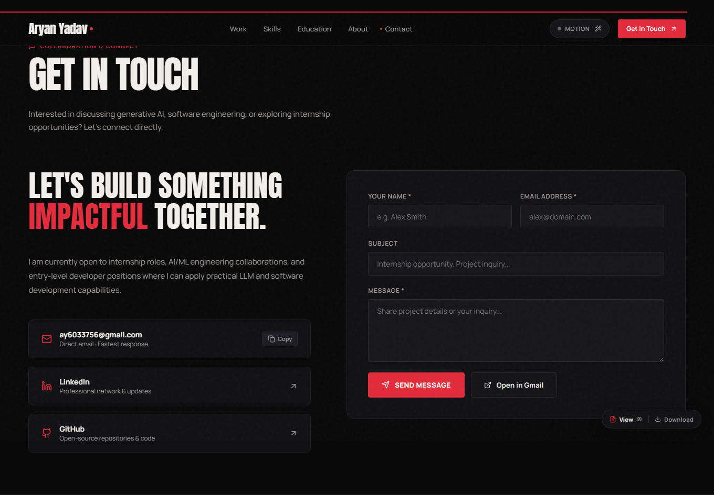

# ⚡ Aryan Yadav — Editorial AI/ML & GenAI Portfolio

<p align="center">
  
</p>

<p align="center">
  <a href="https://github.com/aryxn-builds/Aryan-Portfolio"></a>
  <a href="https://github.com/aryxn-builds/Aryan-Portfolio"></a>
  <a href="https://github.com/imperfec-t/swarmline"></a>
  <a href="https://github.com/aryxn-builds/Aryan-Portfolio"></a>
  <a href="https://github.com/aryxn-builds/Aryan-Portfolio"></a>
</p>

---

## 📌 Overview

A modern, high-performance editorial portfolio engineered for **Aryan Yadav** — an **AI/ML & Generative AI Developer** specializing in Autonomous Multi-Agent Systems, Multimodal RAG pipelines, and Production ML services.

The design takes direct visual inspiration from the editorial typography, brutalist grid discipline, and layered poster aesthetics of [touquirakhtar.com](https://touquirakhtar.com), elevated with crimson neon accents, high-contrast dark mode, and an **autonomous multi-agent rebuild animation (Swarmline)** running live on website launch.

---

## ✨ Key Features & Visual Showcase

### 1. 🐝 Autonomous Swarmline Rebuild Animation (Default on Load)
When a visitor opens the portfolio, an autonomous swarm of **18 collaborative AI agent cursors** (named after LLMs: Claude, Gemini, GPT-4, Llama, Mistral, DeepSeek, etc.) scans the DOM tree in real time, clears the canvas, and systematically reconstructs the entire portfolio right before the user's eyes!

<p align="center">
  
</p>

- **Live DOM Reconstruction:** Agents draw wireframe bounding boxes, render dimension badges, and type text character-by-character.
- **Interactive Bottom HUD:**
  - **Speed Multiplier:** Control pacing from `0.5x` up to hyper-speed `10x`.
  - **Auto-Tour Camera:** Automatically centers and pans the viewport to follow active builder clusters.
  - **Audio Feedback:** Toggles realistic mallet and mechanical keyboard acoustic synthesis.
  - **Agent Diagnostics:** Displays active agent count, total operations, and live rebuild progress percentage.
- **Instant Toggle & Hotkeys:** Press `Alt + Shift + L` or click the **"Motion"** pill in the navigation bar to launch at any time; press `Esc` to immediately restore the live website.
- **Powered by:** Built upon the open-source [imperfec-t/swarmline](https://github.com/imperfec-t/swarmline) engine.

---

### 2. 🎨 Editorial Hero & Neural Portrait Integration
A bold, poster-inspired hero section designed to make an unforgettable first impression.

<p align="center">
  
</p>

- **Editorial Typography:** Massive `Anton` display typography featuring a crimson layered watermark (`PORTFOLIO`) intertwined with body copy and portrait elements.
- **AI Portrait Silhouette:** Real-life portrait with background cleanly segmented via neural matting, blending directly into the portfolio's `#0a0a0c` canvas with radial red backlight spotlights.
- **Live Status Badge:** Pulsating green indicator broadcasting *"Available for AI / ML Roles"*.
- **Impact Metrics Bar:** Highlights core technical milestones: *10+ GenAI Pipelines*, *99.2% OCR Accuracy*, *Sub-800ms Latency*, and *100% Open Source*.

---

### 3. 💼 Featured Production Projects & Architecture Modals
Curated showcase of high-impact AI/ML engineering projects with direct links to live demonstrations and GitHub repositories.

<p align="center">
  
</p>

#### Highlighted Projects:
1. **DocuMind AI** — Production-Grade Multimodal Document Intelligence & RAG System
   - *Tech:* FastAPI, Groq LPU, Llama-3.3-70B, Qdrant Vector DB, BGE-Large-v1.5, Docker.
   - *Highlights:* Hybrid sparse-dense vector retrieval, contextual chunking, sub-800ms p95 latency.
2. **ResearchPilot AI** — Autonomous Multi-Agent Deep Research & Synthesis Engine
   - *Tech:* LangGraph, CrewAI, Tavily Search API, Gemini 2.5 Flash, Streamlit.
   - *Highlights:* Cyclic agent graph with Planner, Web Researcher, Fact-Checker, and Report Synthesizer agents.
3. **Insurance Premium Prediction API** — End-to-End Production ML Regression Pipeline
   - *Tech:* XGBoost, Scikit-learn, FastAPI, Docker, Streamlit.
   - *Highlights:* Rigorous outlier detection, feature engineering, Automated EDA, Docker containerization.

#### Interactive Architecture Dialogs:
Clicking any project opens an in-depth modal featuring technical architecture flowcharts, benchmark metrics, design trade-offs, and source links:

<p align="center">
  
</p>

---

### 4. 📄 Floating Quick-Action Resume Widget & In-App Viewer
A compact floating control pill fixed in the bottom-right corner provides immediate access to the engineer's resume without cluttering page flow.

<p align="center">
  
</p>

- **1-Click Download:** Instantly saves `Aryan_AI_ML_Resume.pdf` locally.
- **In-App Modal Viewer:** Opens a high-resolution interactive viewer with embedded PDF display, quick-action controls, zoom capability, and keyboard escape dismiss.

---

### 5. 📬 Direct Email Delivery & Verified Contact System
Comprehensive contact portal designed to guarantee zero missed opportunities.

<p align="center">
  
</p>

- **Direct Form Submission (AJAX):** Connects to FormSubmit to deliver inquiries directly to `ay6033756@gmail.com` with real-time feedback, loading states, and error handling.
- **1-Click Email Copy:** Click the email card to immediately copy `ay6033756@gmail.com` with visual toast feedback.
- **"Open in Gmail" Web Composer:** A dedicated button that automatically opens Gmail's web composer in a new tab with recipient pre-filled, bypassing desktop mail client configuration issues.
- **Social Ecosystem:** Quick links to GitHub, LinkedIn, and X/Twitter.

---

### 6. ⚡ Minimal Brand Preloader
A sleek, unobtrusive page loader that triggers on initial load, matching the website's signature crimson gradient and dark theme colors to ensure zero flash of unstyled content (FOUC).

---

## 🛠️ Tech Stack & Tools

| Category | Technologies & Tools |
| :--- | :--- |
| **Frontend Framework** | [React 19](https://react.dev/), [Vite 6](https://vitejs.dev/) |
| **Styling & Design System** | Pure CSS3, Semantic Design Tokens, Fluid Typography, CSS Grid / Flexbox |
| **Typography** | Google Fonts: [Anton](https://fonts.google.com/specimen/Anton) (Display), [Manrope](https://fonts.google.com/specimen/Manrope) (Body), [Caveat](https://fonts.google.com/specimen/Caveat) (Accent Handscript) |
| **Motion & Dynamics** | [Swarmline Engine](https://github.com/imperfec-t/swarmline) (Multi-Agent Simulation), CSS Keyframe Animations |
| **Iconography** | [Lucide React](https://lucide.dev/) |
| **Email Gateway** | FormSubmit AJAX Endpoint + Gmail URL Protocol Handler |
| **Testing & Quality** | [Playwright](https://playwright.dev/) for headless browser verification & automated screenshots |
| **Version Control** | Git & [GitHub](https://github.com/aryxn-builds/Aryan-Portfolio) |

---

## 📁 Repository Structure

```text
Aryan-Portfolio/
├── public/
│   ├── assets/
│   │   ├── hero/                  # Portrait cutout & branding assets
│   │   │   ├── aryan-portrait.png # Neural background-removed portrait
│   │   │   └── aryan-raw.jpg      # Original source portrait
│   │   ├── projects/              # Project preview covers
│   │   └── readme/                # High-resolution screenshots for README
│   │       ├── hero-preview.png
│   │       ├── swarm-preview.png
│   │       ├── projects-preview.png
│   │       ├── project-modal-preview.png
│   │       ├── resume-modal-preview.png
│   │       └── contact-preview.png
│   └── Aryan_AI_ML_Resume.pdf     # Official downloadable resume PDF
├── src/
│   ├── components/                # Modular React UI components
│   │   ├── Contact.jsx            # Contact form + 1-click copy + Gmail button
│   │   ├── Education.jsx          # Academic history & certifications
│   │   ├── Header.jsx             # Navigation bar + Motion button
│   │   ├── Hero.jsx               # Editorial hero with layered portrait
│   │   ├── ProjectCard.jsx        # Project preview card
│   │   ├── ProjectDialog.jsx      # Architecture deep-dive modal
│   │   ├── Projects.jsx           # Selected work section
│   │   ├── ResumeModal.jsx        # Fullscreen interactive resume viewer
│   │   ├── ResumePill.jsx         # Bottom-right floating action widget
│   │   ├── Skills.jsx             # Technical skills matrix
│   │   └── SwarmOverlay.jsx       # Swarmline container and HUD controls
│   ├── config/
│   │   └── site.js                # Central configuration (bio, links, swarmline settings)
│   ├── data/
│   │   ├── education.js           # Education & milestones data
│   │   ├── projects.js            # Projects catalog & architecture specs
│   │   └── skills.js              # Categorized technical competencies
│   ├── App.jsx                    # Root layout & modal managers
│   ├── main.jsx                   # React entry point
│   └── styles.css                 # Master design tokens & editorial CSS styles
├── package.json                   # Dependencies and build scripts
├── vite.config.js                 # Vite bundler configuration
└── README.md                      # Documentation
```

---

## 🚀 Getting Started

### Prerequisites
- Node.js `18.0.0` or higher
- npm or yarn

### 1. Clone the Repository
```bash
git clone https://github.com/aryxn-builds/Aryan-Portfolio.git
cd Aryan-Portfolio
```

### 2. Install Dependencies
```bash
npm install
```

### 3. Launch Development Server
```bash
npm run dev
```
Open [http://localhost:3000](http://localhost:3000) in your web browser.

### 4. Build for Production
```bash
npm run build
```
Creates an optimized production bundle inside the `dist/` directory ready for deployment on Vercel, Netlify, or GitHub Pages.

### 5. Preview Production Build Locally
```bash
npm run preview
```

---

## ⚙️ Customization Guide

All data, media, and behaviors are isolated into straightforward configuration files:

- **Personal Details & Social Accounts:** Update [`src/config/site.js`](./src/config/site.js).
- **Projects Catalog:** Add or modify project entries in [`src/data/projects.js`](./src/data/projects.js).
- **Technical Skills Matrix:** Edit categories in [`src/data/skills.js`](./src/data/skills.js).
- **Swarmline Animation Config:** Adjust default on-load behavior (`autoStartSwarm: true | false`), agent count, or speeds in [`src/config/site.js`](./src/config/site.js).
- **Resume File:** Replace [`public/Aryan_AI_ML_Resume.pdf`](./public/Aryan_AI_ML_Resume.pdf) with your updated PDF.

---

## 🤝 Acknowledgments & Credits

- **Swarmline Rebuild Effect:** Built with inspiration and core code patterns from [imperfec-t/swarmline](https://github.com/imperfec-t/swarmline) by [@imperfec-t](https://github.com/imperfec-t).
- **Design Inspiration:** Visual hierarchy and editorial layout inspired by [touquirakhtar.com](https://touquirakhtar.com/).
- **Icons:** [Lucide React](https://lucide.dev/).
- **Fonts:** [Anton](https://fonts.google.com/specimen/Anton), [Manrope](https://fonts.google.com/specimen/Manrope), [Caveat](https://fonts.google.com/specimen/Caveat) via Google Fonts.

---

## 👨‍💻 Author

**Aryan Yadav**
- **Role:** AI/ML & Generative AI Developer
- **Email:** [ay6033756@gmail.com](mailto:ay6033756@gmail.com)
- **GitHub:** [@aryxn-builds](https://github.com/aryxn-builds)
- **Location:** Delhi, India

---

<p align="center">
  <sub>Built with ❤️ by Aryan Yadav · Licensed under the <a href="LICENSE">MIT License</a>.</sub>
</p>
